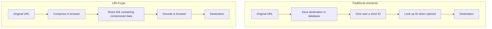
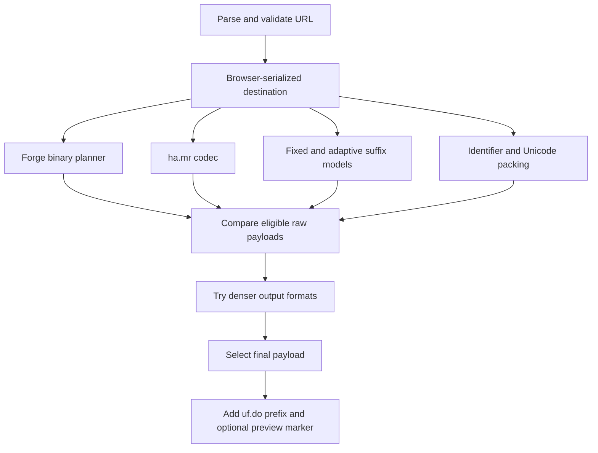
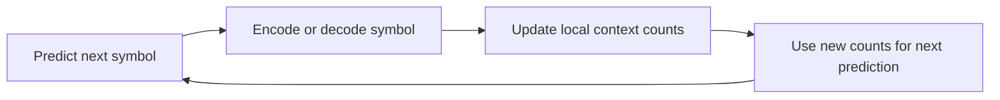
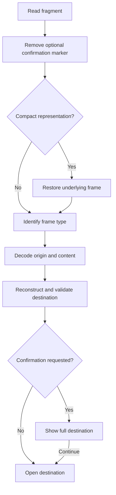

<div align="center">
  <h1>URLForge</h1>
  <p><strong>Shorten URLs locally in your browser.</strong></p>
  <p>Long links, less space. Every compressed link carries its own destination.<br />No account, no database and no server-side URL lookup.</p>
  <a href="https://uf.do/"><strong>Visit uf.do</strong></a> · <a href="https://uf.do/privacy">Privacy</a> · <a href="https://github.com/luizbizzio/urlforge/issues">Feedback</a>
  <br /><br />
  <a href="LICENSE"></a>
  
  
  
</div>
  <br /><br />
  
  <a href="https://uf.do/"></a>


## The shortest way to shorten a link

You are reading an article, looking at a product or sharing a GitHub repository. You want to send the link to someone, but the address is a little too long.

Instead of opening a new tab, copying the address and finding a URL shortener, simply add **`uf.do/`** in front of the full URL in your address bar and press Enter.

```text
https://example.com/articles/technology?source=newsletter
```

becomes:

```text
uf.do/https://example.com/articles/technology?source=newsletter
```

URLForge opens a result page with the compressed link ready to copy. You can also edit the original address, change the compression mode or create a QR code.

Prefer the usual way? Open [uf.do](https://uf.do/), paste your URL and select **Compress link**.

> [!TIP]
> For sensitive URLs, use the form on the home page. The address bar shortcut sends the original address up to its fragment as part of the request to the hosting provider. The form keeps the original URL inside your browser during compression.

## More than a shorter link

| Feature | What you can do |
| :--- | :--- |
| **Compress** | Turn a full HTTP or HTTPS URL into a compact, shareable link. |
| **Compare** | See the final length and how many characters you actually saved. |
| **Choose** | Let Automatic mode pick the best available result, or try URLForge and ha.mr separately. |
| **Share** | Copy the link or open it directly. |
| **Preview** | Let the recipient inspect the full destination before opening it. |
| **Create QR codes** | Download an SVG or a 512 or 1024 px PNG, generated locally. |

There is no signup and no list of saved destinations to manage.

### Try a real example

Look at this address from the project's test suite:

```text
https://example.com/articles/550e8400-e29b-41d4-a716-446655440000
```

URLForge can represent the same destination as:

```text
https://uf.do/#=iQ8s88zZ!e3B+h?Be9K1wCMmnTLgF,8B2
```

| Original | Compressed data | Complete short link | Saved |
| :---: | :---: | :---: | :---: |
| 65 characters | 34 characters | 49 characters | **16 characters (24.6%)** |

The strange-looking part after `#` is not a random ID. It contains the information needed to rebuild that entire address. The example comes from a [real test fixture](test/compact-fragment.test.js); `example.com` is used as an illustrative destination.

### Three modes, one destination

- **Automatic:** the recommended option. It compares the available Forge and ha.mr representations.
- **URLForge:** uses Forge's structural, statistical and exact formats. Some of these use ha.mr to encode the origin.
- **ha.mr:** uses the ha.mr family and its applicable compact wrappers. It rejects URLs it cannot restore exactly.

### Let people see where they are going

Enable **Ask before opening** to display the full destination and its hostname before a visitor continues. URLForge remembers this option in your browser when local storage is available.

| Link shape | Opening behavior |
| :--- | :--- |
| `https://uf.do/#PAYLOAD` | Decode and open the destination automatically. |
| `https://uf.do/#:PAYLOAD` | Show the destination and wait for confirmation. |

The extra `:` changes how the link opens, not the address it contains. It is a preview, not a website safety check.

### From link to QR code

The QR code contains the exact compressed URL. It is generated inside your browser using [uqr](https://github.com/unjs/uqr), without uploading the link to a QR service. Save an SVG for printing or a PNG for everyday sharing. QR generation is available for links up to 2,000 characters, subject to successful encoding.

---

## Where did the missing characters go?

A traditional URL shortener can make almost any address look like `short.example/abc123`. But there is a trick: `abc123` does not contain the original URL. It points to a record stored on a server.

Imagine a locker. You receive a small key, but the object itself remains in the locker. Lose the locker and the key becomes useless.

URLForge asks a different question: **what if the link could carry the object instead of the key?**



The information travels after the `#`, in the URL **fragment**. Browsers do not send that fragment in the HTTP request to the hosting server. When the static site loads, JavaScript reads it, reconstructs the address and opens it locally.

| | Traditional shortener | URLForge |
| :--- | :--- | :--- |
| What travels in the link? | A lookup ID | The compressed destination |
| Where is the destination stored? | Usually a database | Inside the link |
| How is it recovered? | Server lookup | Local decoding |
| How long is the result? | Often a fixed-size ID | Depends on the input |
| Expiration | Depends on the service | No built-in expiration |

The trade-off is important: URLForge cannot make every URL as short as a database ID. It must carry enough information to recover the destination. Links also still need a working host and a compatible decoder.

### A small problem with a big consequence

Imagine an alphabet with just two symbols: `0` and `1`. With three symbols in a row, you can describe eight different possibilities. With two, you can describe only four. There is no way to fit all eight into those four slots without losing something.

```text
3 bits: 000 001 010 011 100 101 110 111    (8 possibilities)
2 bits:  00  01  10  11                    (4 possibilities)
```

That is the fundamental limit of lossless compression. If some inputs get shorter, others must stay longer or grow. The real question is not whether every address can be compressed, but whether **real URLs contain enough predictable structure** to make compression worthwhile.

Look at two examples from the tests:

| Test URL | Original | Complete short link | Savings |
| :--- | ---: | ---: | ---: |
| Article with a UUID | 65 | 49 | 24.6% |
| GitHub repository | 38 | 35 | 7.9% |

```text
Article     Original  ██████████████████████████  65
            Short     ████████████████████        49

Repository  Original  ███████████████             38
            Short     ██████████████              35
```

Each bar is proportional to the character count, with rounded block lengths. These are two test examples, not average benchmark results. Long repetitive URLs and structured IDs often provide opportunities; short addresses and random tokens may not. Sometimes the result is longer. URLForge shows that too.

### What about privacy?

Compression, decompression and QR generation run locally. The address bar shortcut includes the original address up to its fragment in the request to the hosting provider.

Compression is **not encryption**. Anyone who has a compressed link can recover its destination. The site accepts complete HTTP and HTTPS addresses, rejects embedded usernames and passwords, and limits input to 8,192 UTF-8 bytes. See the [privacy page](https://uf.do/privacy).

---

## Inside the codec: how to fit a URL inside a URL

Now for the interesting part. Suppose we need to compress this address without removing a single piece of information:

```text
https://example.com:8443/products/item?id=00001234&lang=en#details
```

A general-purpose compressor sees a string of bytes. URLForge can see something more useful: a protocol, a hostname, a number, a path, named parameters and a fragment. Each part has a different pattern. So why use the same method for all of them?

That question leads to the design of the engine: several reversible representations compete, and the shortest eligible result found wins.



The following sections follow the information through that process, one layer at a time.

### 1. First, decide what must survive

Before compressing anything, the engine uses the browser's WHATWG `URL` API to parse and serialize the address. For example, `https://example.com` becomes `https://example.com/`. Browser serialization can also normalize hostnames and default ports.

This serialized `href` is the target that new links aim to restore exactly. The input is not a list of optional ingredients: parameters, duplicate keys, query order, fragments, leading zeros, lowercase percent escapes and even an empty `?` or `#` can matter.

Removing a tracking parameter could make a URL shorter, but it would change the destination string. URLForge is a compressor, not a URL cleaner.

### 2. A URL is full of things we have seen before

Consider `https://`. It appears in millions of addresses. Why spend seven or eight text characters describing a protocol when a single binary flag can distinguish HTTP from HTTPS?

The Forge core takes this idea further. Its binary stream contains a version header, protocol flag, a sequence of tokens and an end marker. A token is a short instruction the decoder understands.

Imagine a tiny dictionary:

```text
0 → www.
1 → .com
2 → /products/
3 → utm_source=
```

If both sides have this dictionary, sending a reference to entry `2` can replace ten characters with a small instruction. The actual Forge dictionary contains common URL pieces, and its wire tags are more detailed than this example.

Forge can also represent common hosts or domain labels by indexes, encode ports numerically, and recognize certain short URLs, YouTube watch URLs and Google Maps coordinate patterns. These special formats are narrow alternatives: they only apply to matching inputs.

There are typed tokens for decimal values, UUIDs, hexadecimal text, timestamps and suitable binary values. A number token can retain its digit count, so `00001234` does not turn into `1234` on the way back.

### 3. Give common symbols cheaper tickets

A dictionary is useful, but it cannot contain every word or URL. The next trick is to give frequently used symbols shorter binary codes.

Imagine an alphabet with four letters that appear at different rates:

| Symbol | Illustrative probability | Possible Huffman code |
| :---: | ---: | :---: |
| A | 50% | `0` |
| B | 25% | `10` |
| C | 12.5% | `110` |
| D | 12.5% | `111` |

A fixed-length code needs two bits per letter. The example Huffman code uses 1.75 bits per letter on average. Because no code is the beginning of another, the decoder can read the stream without needing separators.

Forge uses a fixed byte-frequency table for its Huffman tokens. But what if the most common symbol becomes even more predictable, with a probability of 90%? Huffman still needs at least one bit for that symbol. Information theory says its ideal cost is only about 0.15 bits.

That is where **arithmetic coding** comes in. Instead of assigning each letter its own fixed code, it repeatedly narrows an interval according to the probability of the next symbol. The final binary value represents the whole sequence. The decoder repeats the same process with the same probability model.

The ideal cost of a symbol with probability `p` is `-log₂(p)` bits:

| Probability | Ideal information cost |
| ---: | ---: |
| 90% | 0.15 bits |
| 50% | 1 bit |
| 25% | 2 bits |
| 12.5% | 3 bits |
| 6.25% | 4 bits |

These numbers describe a theoretical limit, not a measured compression ratio. Real streams also need framing, finite-precision arithmetic and a way to end.

### 4. If something appears twice, why send it twice?

Consider a query with repeated names:

```text
?category=books&category=music&category=games
```

After the first `category=`, the decoder already has those bytes in its output. A later occurrence can be described as a reference: go back a certain distance and copy a certain number of bytes.

```text
category=books & category=music
                 ^^^^^^^^^
                 copy from earlier output
```

This is the idea behind **LZ-style backreferences**. It does not require a predefined dictionary; it builds on data already present in the stream.

Forge's literal planner compares raw UTF-8 blocks, Huffman codes, arithmetic blocks and LZ references using dynamic programming. It accounts for the cost of token tags and lengths, not just the bytes saved. If a compressed block costs more than the raw bytes, the raw representation can win.

<details>
<summary><strong>Inside the Forge core: binary layouts and versioning</strong></summary>

The main combined planner tries multiple layouts of the same address:

| Format | What changes |
| :--- | :--- |
| V5 | Hostname, path, query and fragment encoded as local segments. |
| V6 | Global raw-body encoding, allowing references across component boundaries. |
| V6 query block | An additional representation that considers the query as one literal block. |
| V7 | Adds eligible direct binary tokens and further hostname structure. |
| Exact V7 | Encodes the serialized URL body in one stream, with timestamp tokens disabled. |
| V8 | Experimental context-arithmetic tokens, not enabled by the public combined selector. |

The combined planner compares final encoded character counts and uses bit length to break its internal ties. Intermediate writers can be shared across layouts. The binary decoder recognizes internal versions 1 through 8. The outer legacy meta-v7 format is a different versioning layer from these internal formats.

Source: [`codec.js`](src/codec.js), [`meta-codec.js`](src/meta-codec.js).

</details>

### 5. There is no reason to reinvent every good idea

The engine also includes the unmodified [ha.mr codec by p2r3](https://github.com/p2r3/ha.mr). It is a separate approach to URL compression, not just another name for Forge.

ha.mr recognizes protocol flags, `www.`, index-page suffixes and numeric ports. It uses Huffman-coded dictionaries for common domains and domain endings, then selects suitable character sets or Huffman coding for the remaining segments. URLForge uses its shared 65-character alphabet when calling this codec.

Some URLs fit ha.mr particularly well. Others suit Forge better. The public selector accepts eligible ha.mr outputs only when they restore the intended serialized destination exactly. Manual ha.mr mode rejects unsupported exact inputs instead of silently changing them.

There is another opportunity: what if we use ha.mr for the part it handles well, and Forge for the rest?

### 6. The head and the tail are two different problems

Look at the difference between the origin and the rest of a URL:

```text
https://example.com/ | articles/technology?source=newsletter
        head         |                 tail
```

The origin has a limited structure: protocol, hostname and sometimes a port. The tail can contain almost anything. Forge can encode the origin using ha.mr and compress the tail with its own statistical model. A suitable first directory can also move into the head when that produces a better candidate.

#### Can you guess the next character?

If you see `?utm_`, you might expect an `s`, `m` or `c` to follow. If you see `https`, a `:` is a good guess. A compressor can use the same idea: a better prediction means a lower information cost.

Forge's fixed suffix model uses up to three previous characters to predict the next symbol. It combines frequency counts from a public URL dataset, shorter contexts and character classes, such as digits or lowercase letters. Unusual symbols still receive a nonzero probability.

The model is frozen inside the application. No training service is contacted when you compress a link. Encoder and decoder share exactly the same model, so neither needs to send the model along with every URL.

#### What if the URL teaches the codec as it goes?

Return to our query:

```text
?category=books&category=music&category=games&category=films
```

The first time `category` appears, the fixed model provides a prediction. The second time, the adaptive model has already seen the word. By the fourth occurrence, it has even more evidence that the same pattern may appear again.



The adaptive model remembers contexts of up to eight preceding characters. It tracks paths, query names, query values and fragments separately. Longer matching contexts contribute first, and the frozen model fills the remaining probability mass.

There is no need to transmit a learned dictionary: the decoder learns from each recovered symbol in exactly the same order. The adaptive state belongs to this one operation, not to your browsing history. It is statistical compression, not an external AI service.

<details>
<summary><strong>Inside the suffix model: training, probability and framing</strong></summary>

The fixed model uses 94 printable ASCII symbols plus an end-of-stream symbol. Its probability scale is 4,096; the adaptive model uses 16,384. The arithmetic stream has an explicit end symbol and a leading bit that preserves zero bits when converting to radix 65.

The normal suffix candidate accepts eligible tails from 8 to 2,048 characters. The selector considers adaptive encoding for eligible queries and for eligible longer paths or fragments (at least 24 characters). One separator dot identifies the fixed form, and two identify the adaptive form. Identifier templates can have a shorter minimum.

The fixed model is trained ahead of time using the pinned [Ada URL dataset](https://github.com/ada-url/url-dataset). Domain groups are separated for evaluation, and higher-order contexts are pruned by support and frequency to keep the model compact. The frozen counts and update rules are part of the wire format: changing them for an existing format could make old links decode incorrectly.

Source: [`suffix-codec.js`](src/suffix-codec.js), [`suffix-model-v1.js`](src/suffix-model-v1.js), [`query-model.js`](src/query-model.js), [`train-suffix-model.js`](src/train-suffix-model.js).

</details>

### 7. A UUID is not a sentence

Remember the article URL from the beginning? Its identifier looks like random text, but the structure tells us something useful:

```text
550e8400-e29b-41d4-a716-446655440000
```

It contains 32 hexadecimal digits and four hyphens in known positions. Each hexadecimal digit represents four bits, so the hexadecimal content fits into 128 bits before tags and framing. The hyphens do not need to be described individually if the decoder knows where to put them back.

The same idea works for other identifiers. Forge can split a suffix into a template and fields:

```text
Original: orders/00001234?item=550e8400-e29b-41d4-a716-446655440000

Template: orders/{1}?item={2}
Field 1:  00001234
Field 2:  550e8400-e29b-41d4-a716-446655440000
```

The template is compressed using the fixed suffix model. The fields use separate representations chosen for their structure. During decoding, the fields are inserted back in order. Braces are used here for illustration; the real format has reserved placeholders.

| Field | What the codec can avoid repeating |
| :--- | :--- |
| Decimal digits | The full text spelling of a number, while retaining leading zeros. |
| Hexadecimal digits | Redundant text representation, with supported case preserved. |
| UUIDs | Hyphens at known positions. |
| Percent-escaped bytes | The `%` marker before each byte, when the spelling can be restored. |
| Mixed URL-safe IDs | Extra statistical overhead, by carrying eligible runs verbatim with a tag. |

The identifier codec uses radix-65 integers with type tags and a leading marker to preserve leading zeros. It limits fields to 64 per template and their original lengths to 512 characters. If a field does not fit an exact specialized representation, it can remain in the text.

### 8. Even Unicode can share its common pieces

The word `東京` looks short, but inside a serialized URL path it becomes:

```text
%E6%9D%B1%E4%BA%AC
```

That is eighteen characters to represent two Unicode characters. The URL needs those escape groups, but the compressed data does not necessarily need to repeat them in that form.

Forge's Unicode candidate looks for suitable escaped runs. When code points share their high bits, it stores that common part once and represents their differences with a smaller number of possible values. It can also represent underscores, hyphens and encoded spaces in suitable runs.

The decoder restores the code points and percent escapes, including the supported uppercase or lowercase spelling. Runs that cannot be represented exactly are left to other candidates. The Unicode format wins only when its total representation, including overhead, is shorter.

Source for both identifier strategies: [`identifier-suffix.js`](src/identifier-suffix.js).

### 9. Sometimes being clever is the wrong answer

Consider this address from another test:

```text
https://bad_host.example/a?x=%2f#
```

The lowercase `%2f` and empty `#` are easy to overlook. An older normalization step might turn `%2f` into `%2F` or drop an empty delimiter. But the target is the serialized URL, not a guess about whether another spelling is equivalent.

The selector checks legacy core and ha.mr candidates for exact eligibility. When there is no eligible core Forge candidate, it creates an **exact Forge fallback**, encoding the serialized body as one binary stream with timestamp tokens disabled. The resulting frame can still compete with suffix formats and be wrapped in a denser output format.

This is why the system has a fallback: compression should never save a character by changing the destination it promises to restore.

---

## The last few characters: bits are not yet a link

Everything so far is about reducing the information needed to describe a URL. But there is another problem: browsers and messaging apps share text, not raw binary streams.

Base64url has 64 symbols, meaning each digit can carry six bits. What if we use more symbols? The same information can potentially fit into fewer characters.

| Alphabet | Symbols | Theoretical capacity per digit |
| :--- | ---: | ---: |
| Base64url | 64 | 6.00 bits |
| Safe65 | 65 | 6.02 bits |
| Compact fragment | 76 | 6.25 bits |
| Expanded compact fragment | 79 | 6.30 bits |

This is not the actual compression ratio. Format markers and restrictions reduce usable capacity. Even a small improvement matters when the goal is a shorter link.

### Safe65, compact and expanded

The normal data alphabet is Base64url plus `~`. The binary data is treated as a large integer and written in base 65. Dots are reserved for format prefixes and separators; `#` remains the URL fragment delimiter.

The compact format takes the data-and-dot alphabet and adds ten punctuation symbols. It uses **enumerative coding**: order possible underlying strings, give each a number (a rank), and express that number in a denser set of valid strings. This is reversible, including the length and leading digits of the original representation. An extra marker distinguishes the format, and the string ends in a letter or digit.

The expanded format adds three more symbols, `&`, `'` and `:`, bringing the total to 79. It can represent leading Forge dots through format tags instead of literal dots. It avoids certain collisions with confirmation markers, browser text fragments and HTML entities. The compact formats can also reuse a fixed ha.mr v0 version bit as a tag.

These are not new compression algorithms for the destination itself. They are reversible ways to pack an already compressed representation into fewer text characters. The selector only uses them when they save characters.

### Can a single symbol describe an entire header?

Many links are HTTPS, have no custom port and end in a familiar top-level domain. Some ha.mr v0 header bits are therefore predictable. Forge can remove matching bits and represent them with a final marker, while preserving the `www` flag. The special format only applies when its other header conditions match, including no index suffix.

| Destination domain ending | Final payload marker |
| :---: | :---: |
| `.com` | `$` |
| `.org` | `+` |
| `.net` | `/` |
| `.io` | `=` |
| `.gov` | `@` |
| `.edu` | `&` |

When decoding, the marker tells the engine which bits to restore before calling ha.mr. This candidate can also replace an equally short result ending in `_` or `~`, which some automatic link formatting systems can drop.

Source: [`output-encoding.js`](src/output-encoding.js), [`compact-fragment.js`](src/compact-fragment.js).

## The race for the shortest result

A more advanced algorithm is not automatically a better algorithm for every URL. A statistical model may save bits on a long path but add overhead to a tiny one. A typed identifier can beat text compression on a UUID, while ha.mr might do better on a familiar domain.

So the public selector in [`url-codec.js`](src/url-codec.js) does not pick one universal winner. It compares applicable raw candidates including their format markers, then tries compact wrappers on leading representations: the current winner, the eligible ha.mr candidate and the shortest Forge candidate, when available.

<details>
<summary><strong>All active candidate names at a glance</strong></summary>

| Candidate | What it represents |
| :--- | :--- |
| `combinedRetained` | The best main Forge core layout. |
| `ha.mr` | An exact eligible ha.mr representation. |
| `suffixModel` | Head with a fixed statistical tail. |
| `adaptiveQuery` | Head with an adaptive query-containing tail. |
| `adaptivePath` | Adaptive encoding of eligible longer paths or fragments. |
| `directorySuffix` | First directory in the head, fixed model for the rest. |
| `identifierSuffix` | Text template with separately packed identifiers. |
| `unicodeSuffix` | Text template with eligible packed Unicode runs. |
| `exactForge` | Exact binary fallback when no eligible core Forge candidate exists. |
| `compactFragment` | 76-symbol enumerative wrapper. |
| `expandedCompactFragment` | 79-symbol wrapper. |
| `headerCompactFragment` | Specialized ha.mr HTTPS header wrapper. |

Not every candidate is available for every input or mode. The public selector keeps the earlier candidate on an equal raw length; the compact header rule has the sharing-related exception above. This is a search over the implemented strategies, not proof of a mathematically optimal encoding.

</details>

The final length includes `https://uf.do/#` (15 characters) and the optional `:`. This matters: a payload can be much smaller than an original URL but still produce a longer complete link. The site compares the complete addresses, not just the compressed data.

## Now run the entire process backwards

Remember the first example? We started with 65 characters and finished with a 49-character link. Here is the actual underlying frame and its compact representation from the project's tests:

```text
Original:    https://example.com/articles/550e8400-e29b-41d4-a716-446655440000
Raw frame:   u78r.BCY-Wx7.ezAjsSg5FyxCWvUFihdXhY
Compact:     =iQ8s88zZ!e3B+h?Be9K1wCMmnTLgF,8B2
Final link:  https://uf.do/#=iQ8s88zZ!e3B+h?Be9K1wCMmnTLgF,8B2
```

The raw frame is already compressed. The compact layer packs it again into a slightly shorter string. The decoder does not need to know the original address in advance. It only needs the data and the matching format rules.



For this UUID example, the compact decoder restores the raw identifier frame, the head restores the origin, and the suffix decoder inserts the UUID into the recovered template. No database record is needed.

<details>
<summary><strong>How the decoder knows which format to use</strong></summary>

The fragment itself carries its framing information. These are schematic shapes, not literal links:

| Shape | Meaning |
| :--- | :--- |
| `BODY` | Legacy ha.mr payload. |
| `.BODY` | Legacy meta-v7 Forge frame. |
| `..BODY` | Exact Forge binary body. |
| `HEAD.TAIL` | Fixed suffix with origin or directory head. |
| `HEAD..TAIL` | Adaptive suffix. |
| `HEAD.SHAPE.FIELD...` | Identifier or Unicode template and fields. |
| Compact punctuation forms | Restore a frame through the compact, expanded or header format. |

The confirmation marker is removed before format detection. Old meta-v7 links remain readable, including their legacy normalization behavior. The newer exact frames validate the recovered serialized URL. The public decoder limits payloads to 8,192 characters, with a 65,536-byte decoded URL limit in the Forge core and further limits on token counts, backreferences and suffix fields. Invalid frames and decoding failures produce an error rather than a redirect.

Source: [`url-codec.js`](src/url-codec.js), [`meta-codec.js`](src/meta-codec.js), [`src/web/redirect.js`](src/web/redirect.js).

</details>

## How do we know nothing was lost?

Compression is only useful if we can reverse it. The most important test is not how small the output gets, but whether the decoder reconstructs the correct address.

URLForge includes round-trip and property tests, malformed-payload tests, legacy compatibility checks and web integration tests. They cover percent escapes, Unicode, repeated query parameters, QR generation and preview mode.

The [current suffix benchmark](src/suffix-benchmark.js) measures the full link length using the same base for competing codecs. It records wins, ties, losses, character savings and 95th-percentile encoding and decoding times in Node.js. A reference that cannot restore the serialized destination exactly is excluded from the exact comparison.

The evaluation uses generated development, holdout and unseen inputs, a [public Hacker News sample](test/fixtures/hacker-news-2026-11-23.txt) and optional data from the [Ada URL dataset](https://github.com/ada-url/url-dataset). The [historical reports](reports/) contain earlier research results, not a fresh benchmark for the current selector.

The interesting result is not that every URL gets shorter. It is that a browser can recover a complete address from a compact representation using nothing more than the information carried by the link and the decoder's shared rules.

## Credits and license

URLForge includes the unmodified [ha.mr codec](https://github.com/p2r3/ha.mr) by p2r3 under its original [MIT license](vendor/ha.mr/LICENSE). QR generation uses [uqr](https://github.com/unjs/uqr).

The repository's [LICENSE](LICENSE) contains the Apache License 2.0. Third-party components retain their own licenses.

<div align="center">
  <p><strong>Next time you have a long link, try giving it a little less space.</strong></p>
  <a href="https://uf.do/">uf.do</a>
</div>
