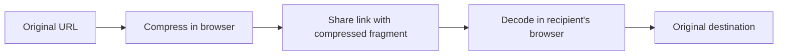

<div align="center">
  <h1>URLForge</h1>
  <p><strong>Shorten URLs locally in your browser.</strong></p>
  <p>Every compressed link carries its own destination. No account or database required.</p>
  <a href="https://uf.do/"><strong>Try URLForge</strong></a> · <a href="https://uf.do/privacy">Privacy</a> · <a href="https://github.com/luizbizzio/urlforge/issues">Feedback</a>
  <br /><br />
  <a href="https://uf.do/"></a>
</div>

## Try it

Paste a URL at [uf.do](https://uf.do/) and select **Compress link**. You can also add `uf.do/` before a full URL in your address bar to open a result page with the compressed link ready to copy.

```text
uf.do/https://example.com/articles/technology?source=newsletter
```

For sensitive URLs, use the form. The address bar shortcut sends the original address up to its fragment as part of the request to the hosting provider. See the [privacy policy](https://uf.do/privacy).

## How can a link carry its own destination?

This article URL goes from **65 to 49 characters** (24.6% shorter), counting the complete link, including `https://uf.do/#`. The pair comes from a [round-trip test](test/compact-fragment.test.js).

- **Original** <https://example.com/articles/550e8400-e29b-41d4-a716-446655440000>
- **Compressed** <https://uf.do/#=iQ8s88zZ!e3B+h?Be9K1wCMmnTLgF,8B2>

The text after `#` is the URL fragment. It contains the compressed destination, and the browser keeps it out of the HTTP request to the hosting server. When the page loads, the decoder reads that fragment, rebuilds the destination and opens it without a database lookup.



The article's UUID gives the codec something to work with. Its 32 hexadecimal digits fit into 128 bits, and the decoder can put the four hyphens back in their known positions. For this URL, the codec packs the origin, an article path template and the UUID separately. Other inputs may benefit from common URL patterns or repeated text.

Compression is lossless with respect to the URL as serialized by the browser. Query order, leading zeros and the original fragment can all matter. Very short URLs or random tokens may produce a link that stays the same length or grows, because the compressed data still needs room for the site address and format markers. The result page compares both full lengths.

## Sharing options

- **Compression mode.** Automatic picks the shortest result it finds across the Forge and ha.mr codec families. You can also select either family directly.
- **Confirmation.** Turn on **Ask before opening** to let recipients see the destination and choose whether to continue. Standard links start with `/#` and open automatically. Confirmation links start with `/#:`.
- **QR codes.** Download an SVG or PNG generated on your device. Anyone with the link or its QR code can recover the destination.

## Run locally

With a [supported Node.js version](package.json), run these commands from the repository root.

```sh
npm ci
npm run dev
```

Run `npm test` for round-trip, compatibility and web tests, or `npm run build` to build the static site. Run `npm run benchmark:suffix` to compare full link lengths with the same base for both codecs. The [benchmark source](src/suffix-benchmark.js) contains the input selection and exact round-trip checks. [Historical reports](reports/) preserve results from earlier experiments.

## Inside the codec

<details>
<summary><strong>Binary layouts, dictionaries and repeated text</strong></summary>

### Preserving the serialized URL

The encoder parses the input with the WHATWG `URL` API. Serialization can normalize hostnames and default ports and adds the trailing slash in `https://example.com/`. The serialized `href` is what exact formats restore. That includes duplicate query keys, their order, percent escapes, and an empty `?` or `#` when present.

The selector checks legacy Forge and ha.mr candidates for exact eligibility. When no core Forge candidate qualifies, the exact fallback encodes the serialized body as one stream with timestamp tokens disabled. It can compete with suffix candidates and use a compact wrapper.

### Choosing binary tokens

The Forge binary stream has a version header, a protocol flag, a sequence of tokens and an end marker. Shared tokens can represent common hostnames, domain labels and URL pieces by index. Specialized tokens handle eligible ports, decimal values, UUIDs, hexadecimal text, timestamps and binary values. A decimal token can preserve its digit count so a value such as `00001234` survives intact.

The literal planner compares raw UTF-8, Huffman coding, arithmetic coding and LZ-style backreferences using dynamic programming. Huffman assigns shorter codes to more frequent bytes. Arithmetic coding narrows a shared probability interval as each symbol is encoded. A backreference copies bytes the decoder has already recovered. The planner includes tag and length overhead in its comparison.

| Layout | What it represents |
| :--- | :--- |
| V5 | Hostname, path, query and fragment as local segments. |
| V6 | A shared body stream that allows references across component boundaries. A variant considers the query as one literal block. |
| V7 | Additional hostname structure and eligible direct binary tokens. |
| Exact V7 | The serialized body in one stream, with timestamp tokens disabled. |
| V8 | Context arithmetic tokens reserved for experiments outside the public selector. |

The combined planner compares encoded character counts and breaks internal ties by bit length. The binary decoder recognizes internal versions 1 through 8. Legacy meta-v7 has its own outer framing.

[Binary codec source](src/codec.js) · [Legacy frame source](src/meta-codec.js)

</details>

<details>
<summary><strong>Suffix models, identifiers and Unicode</strong></summary>

### Compressing the head and tail

Forge can use [ha.mr](https://github.com/p2r3/ha.mr) for the origin and apply a different representation to the rest of the URL. A suitable first directory can also become part of the head. The tail may contain a path, query or fragment with very different patterns from the hostname.

A fixed statistical model predicts the next symbol using up to three preceding characters, shorter contexts and character classes. Its frequency counts come from the pinned [Ada URL dataset](https://github.com/ada-url/url-dataset), with domain groups kept separate for evaluation. Arithmetic coding turns those probabilities into a compact stream. The ideal information cost of a symbol with probability `p` is `−log₂(p)` bits, before framing and finite-precision overhead.

The adaptive model also updates counts as it goes. It tracks contexts of up to eight characters and distinguishes paths, query names, query values and fragments. The decoder makes the same updates in the same order using the symbols it has recovered. The fixed counts and adaptive rules are part of the format for existing links.

The fixed model uses 94 printable ASCII symbols and an end symbol. Its probability scale is 4,096, while the adaptive model uses 16,384. The fixed candidate handles eligible tails from 8 to 2,048 characters. Adaptive encoding is available for eligible queries and for longer eligible paths or fragments from 24 characters.

### Packing fields with known structure

Identifier formats split the suffix into a template and typed fields. The fixed model encodes the template, and each field uses a representation suited to its structure. Decimal fields preserve their length, UUIDs restore their hyphens and eligible percent-escaped bytes restore their original spelling. Radix-65 integers use type tags and a leading marker to preserve leading zeros. The format limits fields to 64 per template and 512 original characters per field.

The Unicode candidate finds suitable percent-escaped runs. Code points with shared high bits can store that part once and encode their differences with fewer possible values. The decoder restores the code points and supported escape casing. The format also handles eligible underscores, hyphens and encoded spaces within those runs.

[Suffix codec](src/suffix-codec.js) · [Fixed model](src/suffix-model-v1.js) · [Adaptive model](src/query-model.js) · [Training script](src/train-suffix-model.js) · [Identifier and Unicode formats](src/identifier-suffix.js)

</details>

<details>
<summary><strong>From compressed bits to shareable characters</strong></summary>

The URL still needs a text representation. Safe65 treats binary data as a large integer and writes it using the Base64url alphabet plus `~`. Dots serve as frame markers and separators. A larger alphabet can carry more information per character, with some of that capacity used for markers and syntax constraints.

| Alphabet | Symbols | Theoretical bits per digit |
| :--- | ---: | ---: |
| Base64url | 64 | 6.00 |
| Safe65 | 65 | 6.02 |
| Compact fragment | 76 | 6.25 |
| Expanded compact fragment | 79 | 6.30 |

Compact fragments use enumerative coding. They rank valid underlying strings and express the rank in a denser alphabet while preserving length and leading digits. The expanded form adds `&`, `'` and `:`. It uses framing rules to avoid colliding with confirmation markers, browser text fragments and HTML entities.

An eligible ha.mr v0 HTTPS header can also be represented by a final marker. The marker restores matching header bits for common domain endings, keeping the `www` flag intact. In eligible ties, this format can replace a payload ending in `_` or `~` that some apps might strip.

[Output encodings](src/output-encoding.js) · [Compact and header formats](src/compact-fragment.js)

</details>

<details>
<summary><strong>How the selector and decoder read each format</strong></summary>

The selector compares applicable raw candidates and then tries compact wrappers on the leading representations. These include the raw winner, the eligible ha.mr candidate and the shortest Forge candidate when available. The site displays the full link length, which includes the 15-character `https://uf.do/#` prefix and the optional confirmation marker.

For the article URL above, the compact decoder recovers the identifier frame `u78r.BCY-Wx7.ezAjsSg5FyxCWvUFihdXhY`. The head supplies the origin, and the suffix decoder inserts the UUID into the recovered path template.

| Frame shape | What the decoder reads |
| :--- | :--- |
| `BODY` | Legacy ha.mr payload. |
| `.BODY` | Legacy meta-v7 Forge frame. |
| `..BODY` | Exact Forge binary body. |
| `HEAD.TAIL` | Fixed suffix with an origin or directory head. |
| `HEAD..TAIL` | Adaptive suffix. |
| `HEAD.SHAPE.FIELD...` | Identifier or Unicode template and fields. |
| Compact punctuation forms | An underlying frame restored by a compact, expanded or header decoder. |

The redirect handler removes the optional confirmation marker before format detection. The decoder supports legacy links and validates the serialized URL in newer exact frames. It limits payloads to 8,192 characters, with separate bounds on decoded bytes, token counts, backreferences and suffix fields. An invalid frame displays an error.

[Selector and decoder](src/url-codec.js) · [Redirect handling](src/web/redirect.js) · [Compatibility tests](test/compact-fragment.test.js)

</details>

## Credits and license

URLForge is licensed under the [Apache License 2.0](LICENSE). It includes the [ha.mr codec](https://github.com/p2r3/ha.mr) by p2r3 under its [MIT license](vendor/ha.mr/LICENSE) and uses [uqr](https://github.com/unjs/uqr) for QR codes. See [SECURITY.md](SECURITY.md) to report a vulnerability.
